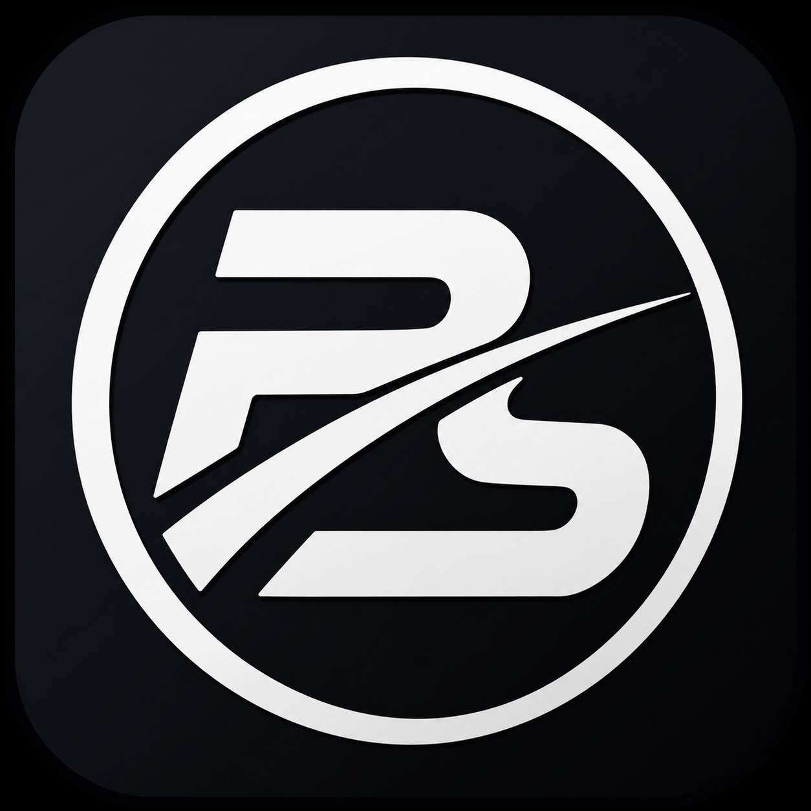

<h1 align="center">BimmerStein ECU Tool</h1>

<strong>BMW MS41, MS42 and MS43 programming and diagnostics</strong>

<a href="https://github.com/CAATZ/BimmerStein-ECU-Tool/releases">Windows releases</a> ·
<a href="manual/USER_MANUAL.md">User manual</a> ·
<a href="https://github.com/CAATZ/BimmerStein-ECU-Tool/issues">Issues and feedback</a> ·
<a href="#acknowledgements">Acknowledgements</a>

<code>Windows x64 / x86</code> · <code>MS41 / MS42 / MS43</code> · <code>GPL-3.0-only</code>

## Overview

BimmerStein ECU Tool brings BMW Siemens **MS41, MS42 and MS43** programming,
diagnostics, calibration work and recovery together in one Windows application.
It supports work with a connected ECU and offline work with saved images,
backups and logs.

- **Read and write ECU files:** full ROMs and calibration regions, with checksum
  checking, correction and optional backup and readback verification.
- **Fast transfers and recovery:** stock DS2, temporary MS42/MS43 RAM agents and
  MS41 Soft-BSL, with fallback before erase and recovery for interrupted writes.
- **Diagnostics:** ECU identification, plain-English fault descriptions,
  supported freeze frames, actuator tests, adaptations and cylinder roughness.
- **Live Data:** selectable channels, graphs, gauges and CSV recording; saved
  logs open in the same viewer, with adjustable panels and display preferences.
- **ECU identity and storage:** VIN and programming history, pairing information,
  memory backups, comparisons and editing of supported stored fields.
- **ECU configuration and coding:** family-specific controls and guided
  transmission conversion for supported vehicle profiles, with review before
  writing. Coding remains highly experimental.
- **Offline calibration tools:** ROM analysis with user-managed definitions,
  file comparisons, calibration extraction and a Bins library for organizing
  reads, imports and prepared images.
- **MS41 firmware patches:** inspect installed revisions, configure supported
  features and compose images with dependency, collision and checksum checks.
- **MS41 recovery tools:** guided Soft-BSL installation and a separate hardware
  bootstrap workflow for supported Intel and AMD/JEDEC flash devices.

Available features depend on the ECU family, firmware, flash device and vehicle
module. The [user manual](manual/USER_MANUAL.md) explains the individual workflows;
the [MS42/MS43 guide](docs/MS42_MS43.md) lists revision coverage and current limits.

### Current release

[**Beta 19 — 0.1.0b19**](https://github.com/CAATZ/BimmerStein-ECU-Tool/releases/tag/v0.1.0b19)
adds MS42/MS43 support, expands diagnostics and storage tools, and includes
MS41 Ignition Cut and Launch Control V18. See the [release notes](RELEASE_NOTES.md)
for the changes and validation limits. Windows installers and complete portable
packages are available for x64, x86, Windows 7 x64 and Windows 7 x86.

## Acknowledgements

Shared ideas, technical work and hands-on testing have helped shape BimmerStein
ECU Tool. Special thanks to the people behind those contributions:

| Contributor | Contribution |
| --- | --- |
| [**NXT-Tronic**](https://github.com/NXT-Tronic) and [**grantUser**](https://github.com/grantUser) | Collaborative ideas and development feedback |
| [**Diolum**](https://github.com/Diolum) | Shared ideas, MS41 research and technical information |
| **Alpine** | Beta testing |
| **roimaomanik** | Beta testing |
| **Alphamk4** | MS41.0 patch testing |
| [**kimfreding**](https://github.com/kimfreding) and **jpiccari** | MS41 CRC-16 checksum work underlying the [checksum implementation](https://github.com/CAATZ/BimmerStein-ECU-Tool/blob/main/engines/bsl/ms41_checksum.py) |
| [**keyhana**](https://github.com/keyhana) | C166 assembly and firmware inspection support |
| [**handmade0octopus**](https://github.com/handmade0octopus) | DS2 protocol references and the boot recovery idea |

Source credits and dependency licenses are retained with the relevant code and
in the [dependency notices](THIRD_PARTY_NOTICES.md).

## Important use limits

> [!IMPORTANT]
> **OFF-ROAD, COMPETITION, RESEARCH, AND BENCH USE ONLY.** You are responsible for
> compliance with applicable emissions, safety, registration and other laws.

> [!WARNING]
> **CODING IS HIGHLY EXPERIMENTAL AND NOT RECOMMENDED UNTIL FURTHER TESTING.**
> This includes guided transmission conversion. Keep the original coding and a
> suitable recovery method before changing a module.

> [!WARNING]
> **IGNITION CUT AND LAUNCH CONTROL ARE HIGHLY EXPERIMENTAL.** They have not
> completed vehicle validation. Do not rely on them for engine protection.
> Ignition cut can send unburned fuel into the exhaust; do not use it with
> catalytic converters fitted. Patches marked **Untested** remain untested.

Use a stable regulated supply and keep a verified original backup. If a write
fails after erase begins, **keep ignition ON, leave the adapter connected and
keep the application open**. Follow the displayed recovery instructions. Do not
cycle power while a retained recovery session is available.

After a successful flash, follow the app's ignition-cycle instructions before
reconnecting. Installing or updating the Windows application does not flash an ECU.

## Supported workflows

| Area | Support |
| --- | --- |
| ECU families | MS41.0, MS41.1, MS41.2, MS41.3, MS42 and MS43 |
| Full ROM files | MS41: 256 KiB; MS42/MS43: 512 KiB |
| Calibration files | MS41: 24 KiB; MS42: 32 KiB; MS43: 64 KiB |
| Diagnostics | ECU information, supported fault memories, live values, actuator tests and adaptations |
| Vehicle modules | Faults and exact-profile coding on supported chassis and modules |
| Storage | MS41 512-byte EEPROM; MS42 16 KiB flash journal; MS43 2 KiB EEPROM and separate 16 KiB raw flash banks |
| Offline work | Image analysis, checksums, comparisons, Bins, calibration extraction and supported configuration edits |
| MS41 recovery | Soft-BSL and hardware BSL, including supported Intel and AMD/JEDEC flash devices |

Available functions depend on the detected firmware and fitted hardware. The app
does not treat an unknown firmware revision or module layout as a supported one.
MS41 Soft-BSL, hardware-BSL controls and the Patches catalog remain MS41-specific.

## Flashing and recovery

Automatic transfer uses the supported fast route and can fall back to stock DS2
when the ECU is confirmed ready for it. MS41 and MS43 use up to **187,500 baud**;
MS42 uses up to **166,667 baud**. **Settings → Compatibility — 125,000 bps** applies
to supported high-speed reads and writes. Normal diagnostics use 9,600 baud.

MS42/MS43 RAM agents are temporary: they load into RAM for the operation and
restart the ECU on completion. They do not require installing a persistent
loader. Reads using this route require the engine to be stopped.

Fallback is limited to a recoverable state before erase. After programming may
have started, recovery keeps the active session and prepared image. It does not
silently reconnect or switch protocols.

**Back up before write** and **Verify after write** follow your selections.
Required ECU-side finalization is separate from optional host readback. Including
boot code requires explicit **WRITE BOOT** confirmation. MS42/MS43 boot writes
require the RAM agent; stock DS2 writes preserve boot code. The identity-preserve
option keeps the live VIN/history, pairing records and ECU identifiers when boot
code is replaced. It does not clone or overwrite separate EEPROM storage.

### MS41 Soft-BSL

Soft-BSL installs a small persistent loader in ECU flash through a guided
workflow. The loader then accepts the matching Intel or AMD/JEDEC agent over
the existing K-Line connection and runs it from RAM for fast reads and writes.
Normal Soft-BSL operation does not require a separate bench connection after
installation.

The installer identifies the ECU and flash family, prepares and verifies the
loader, and checks normal DS2 communication after the guided ignition sequence.
The temporary installation entry is removed after successful installation.
Once detected, a compatible Soft-BSL loader is selected automatically by the
Flash tab. Interrupted writes retain the active agent and prepared image for
recovery.

Soft-BSL installation changes ECU firmware and is recovery-sensitive. Follow
every ignition prompt and keep a suitable recovery method available. Supported
29F400BB dual-bank workflows can manage both halves; boot, golden-bank and
cross-bank operations require the correct physical bank and wiring.

This persistent MS41 loader is separate from the temporary MS42/MS43 RAM-agent
route, which does not install a loader in flash.

### MS41 hardware recovery

The hardware-BSL workflow can recover an unbootable MS41 through a separate,
direct ASC0 connection. It supports the documented Intel 28F200 and AMD/JEDEC
29F200/29F400 configurations. Intel flash programming requires the correct
external VPP/RP# supply; AMD/JEDEC devices use a different programming method.

See the [hardware recovery companion](https://github.com/CAATZ/MS41-BSL-Unbricker)
for wiring and setup. This is an advanced MS41 workflow, separate from normal
K-Line flashing and MS42/MS43 RAM-agent access.

## Diagnostics, adaptations and coding

Read ECU identification, stored faults and supported freeze-frame details,
with English descriptions and raw records available for inspection. The
diagnostics view also provides actuator tests and cylinder roughness monitoring
where supported. Adaptation values can be read and supported groups reset
through their dedicated controls.

Vehicle scanning extends diagnostics to supported transmission, ABS and other
modules. Coding and guided manual/automatic transmission conversion use exact
vehicle and module profiles, with review, recovery records and verification.
An unsupported module or donor combination is not treated as interchangeable.
**Coding and transmission conversion remain HIGHLY EXPERIMENTAL and are not
recommended until further testing.**

## ECU data and identity

For MS42/MS43, **ECU Data → Read Identity / History** reads identification and
programming records. **Read Flash Journal**, **Read EEPROM** and **Read Flash
Banks** back up the selected storage. The selected memory and the loaded backup
are labelled separately.

The storage editor shows established units and named fields where available.
Unknown values remain raw or read-only. Applying an edit updates the loaded
backup; restoring it to the ECU is a separate confirmed action. Calibration-
dependent fields require the matching calibration.

VIN editing and optional virginizing are separate from ordinary flashing.
Virginizing clears supported pairing data and optionally VIN/programming history;
it does not perform EWS alignment automatically. See the
[MS42/MS43 guide](docs/MS42_MS43.md) and [MS41 EEPROM guide](docs/MS41_EEPROM.md).

MS41's EEPROM editor includes decoded fields, raw inspection, learned-knock
grids, undo/redo and named comparisons for known layouts. Record-check repair
is an explicit action; repairing a check does not prove the stored values are
correct. EEPROM restoration is separate from ordinary ROM flashing.

## Live Data and logging

Live Data covers mapped engine values such as RPM, temperatures, throttle,
airflow, ignition, fuel trims, oxygen-sensor values and supply voltages. Channel
availability and scaling follow the detected ECU profile. Values without a
verified mapping remain unavailable rather than using a guessed address.

**Values**, **Graphs** and **Instruments** share your selected channels. View live
data or open a saved CSV, adjust the panel dividers, and save your preferred
instruments. CSV logging retains the complete session; the live viewer keeps a
bounded recent history. Stop polling before changing logger definitions.

Polling modes and rates depend on the selected logger. MS41 supports grouped
DS2 reads and Telegram polling, with compatible logger definitions available
alongside the bundled profiles. Live Data polling does not write ECU flash.

## ROM analysis and Bins

The ROM Analyzer inspects saved firmware without an ECU connection. Import
matching calibration definitions to identify supported parameters and tables;
the parameter view can be detached for more workspace. Check that definitions
match the image before interpreting addresses or values.

**Bins** organizes reads, imports and prepared files with notes, checksums and
comparisons. Folders correspond to real directories in **backups/**; moving or
renaming files preserves their recorded metadata when the match is unambiguous.
Supported files open in the app's analysis, configuration or patch views.

Select two entries to compare their hashes, identified software, checksums,
patches and changed-byte ranges. Folder and search filters help manage a larger
library; imports and prepared images retain their own entries and metadata.
Recovery-storage directories are kept out of the normal library scan.

The **Open in**, **Organize** and **Browse** menus group analysis, file management
and log/recovery-file access. A compatible installed
[BimmerStein Tuning Suite](https://github.com/CAATZ/bimmerstein-tuning-suite) can
receive a separate editable copy of a BIN; import the saved result back into
Bins when ready.

## MS41 firmware patches

The Patches tab detects installed and deprecated revisions, checks dependencies
and byte collisions, applies the selected configuration, corrects checksums and
saves the composed image in Bins. Availability depends on the identified MS41
variant and the patch's exact supported firmware. The patch catalog is
MS41-specific.

Each revision retains its own testing status. **Untested** patches remain
untested; **Ignition Cut and Launch Control are HIGHLY EXPERIMENTAL** and have
not completed vehicle validation. Do not use them for engine protection or
use ignition cut with catalytic converters fitted.

Every Windows package includes `BimmerStein MS41 Patch Definitions.xml` beside
the executable. It exposes calibration items introduced by supported patches
to a compatible calibration editor. Install the matching patch before editing
its tables, and match the ECU variant, calibration and patch revision. A
mismatched definition can point to the wrong addresses.

## Installation

1. Choose x64 for 64-bit Windows or x86 for 32-bit Windows. Use the separately
   labelled **Windows 7** package on Windows 7 SP1.
2. Run the installer, or extract the entire portable ZIP to a writable folder.
3. Install the driver for your FTDI adapter, then start **BimmerStein ECU Tool**.

Keep the complete application folder together. Required runtimes, resources,
manual and license notices are included. Installers use a per-user location;
updates retain an existing installation location. Compare downloads with the
release SHA-256 checksums. Packages may be unsigned.

D2XX is preferred for supported fast FTDI transfers. Normal DS2 and supported
hardware-BSL paths can use the standard serial fallback where D2XX is unavailable.

The application stores reads and recovery files in **backups/** and session logs
in **logs/** beside the executable. These files can contain VIN and ECU identity
information; keep them private and back them up before replacing a portable folder.

## Documentation and support

- [User manual](manual/USER_MANUAL.md) and [illustrated PDF](output/pdf/BimmerStein-ECU-Tool-User-Manual.pdf)
- [MS42/MS43 support](docs/MS42_MS43.md) and [MS41 EEPROM](docs/MS41_EEPROM.md)
- [Release notes](RELEASE_NOTES.md)
- [Build instructions](BUILDING.md)
- [Hardware-BSL recovery companion](https://github.com/CAATZ/MS41-BSL-Unbricker)
- [BimmerStein Tuning Suite](https://github.com/CAATZ/bimmerstein-tuning-suite)
- [Report a problem](https://github.com/CAATZ/BimmerStein-ECU-Tool/issues)

The build label opens **About**, including the support-bundle export. Reports
should include ECU software, Windows version, adapter, operation, exact message
and last completed step. Remove personal information before sharing logs or
screenshots. Raw ROMs are not included in support bundles.

## License and disclaimer

Copyright (C) 2026 CAATZ. Distributed under [GNU GPL version 3](LICENSE)
(GPL-3.0-only). Required dependency [notices](THIRD_PARTY_NOTICES.md) and
[license texts](THIRD_PARTY_LICENSES/) remain included.

The software is provided "as is", without warranty. ECU programming, coding,
patches and recovery can cause data loss, an unbootable ECU, engine or vehicle
damage, or unsafe behavior. You assume the risks of use and are responsible for
backups, stable power and recovery. Offline verification does not establish
physical behavior on every ECU or vehicle.

BimmerStein ECU Tool is independent software and is not affiliated with or
endorsed by BMW AG or interface manufacturers. Nothing in this notice limits
rights granted under the GNU GPL version 3.
