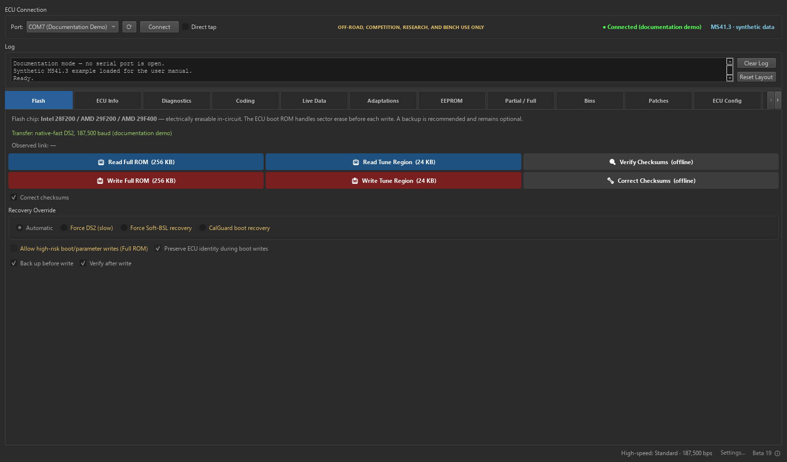
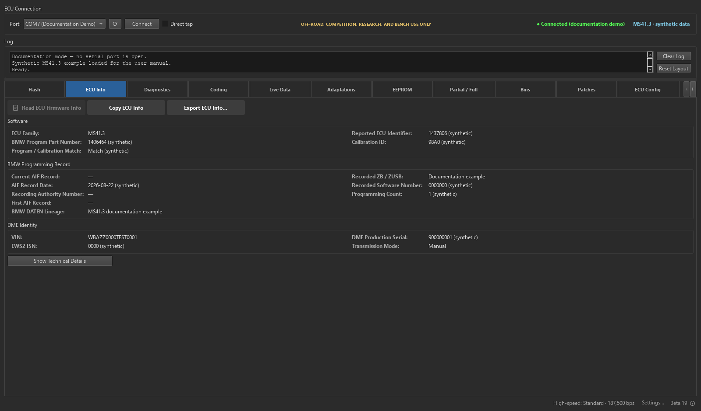
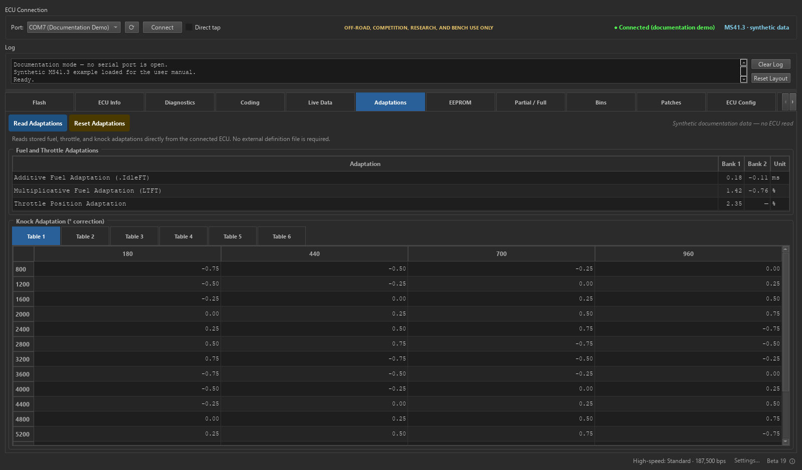
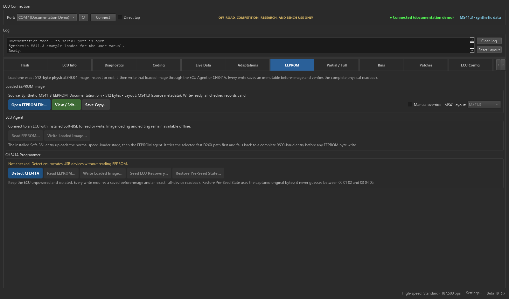
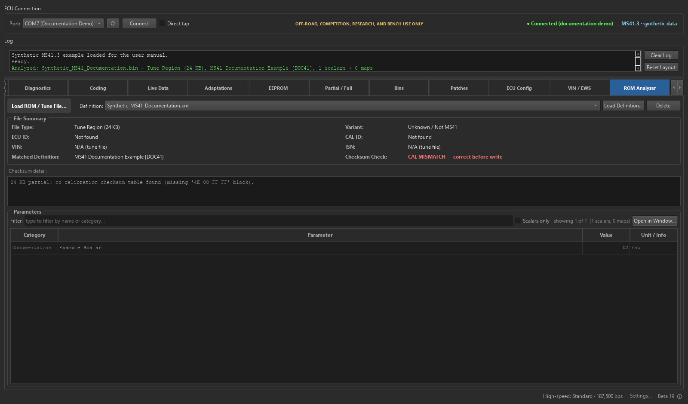
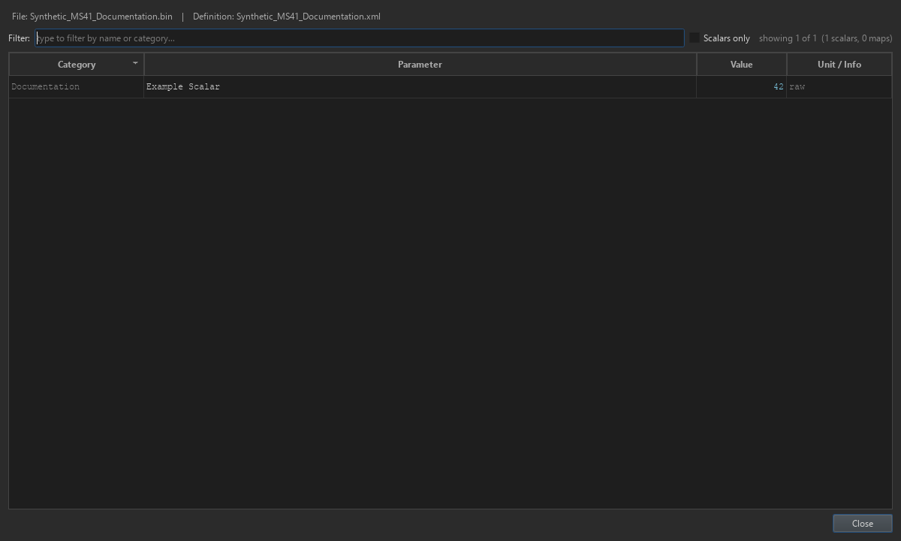
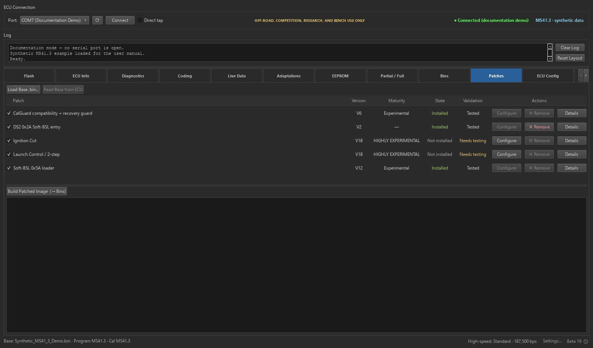
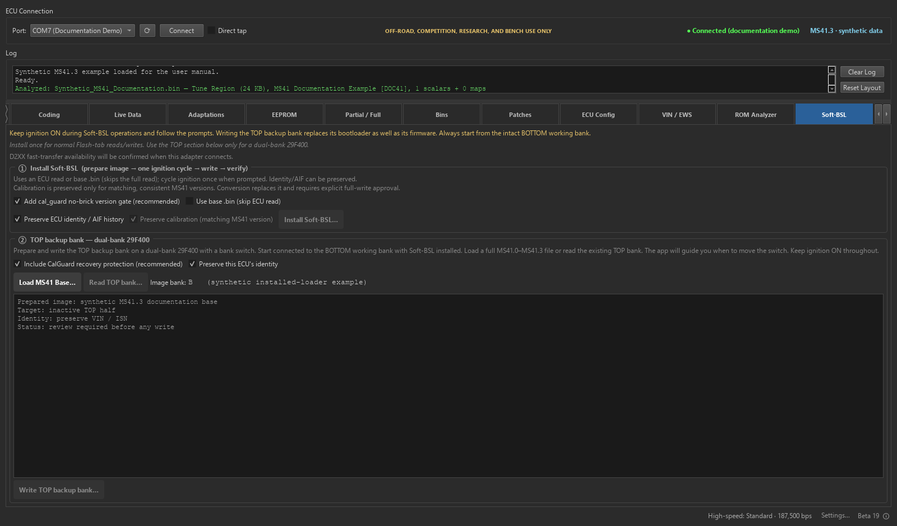
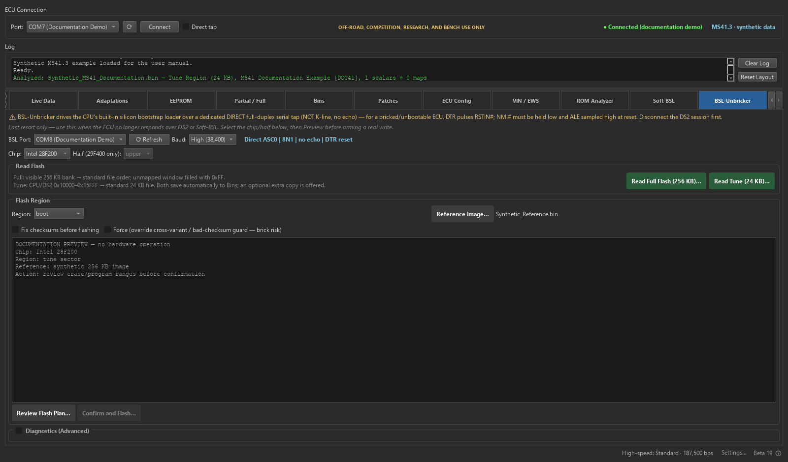

# BimmerStein ECU Tool User Manual

**BMW MS41, MS42 and MS43 programming and diagnostics**

Version 0.1.0b19 - Windows x64/x86 and Windows 7 x64/x86

BimmerStein ECU Tool combines flashing, diagnostics, live data, ECU configuration
and offline files in one desktop application. MS42/MS43 use temporary RAM agents
for supported fast reads and writes. MS41 also offers persistent Soft-BSL,
hardware bootstrap recovery and its firmware-patch catalog.

<!-- pagebreak -->

## Safety first

Read this section before connecting to an ECU or opening a write workflow.

> [!IMPORTANT]
> **OFF-ROAD, COMPETITION, RESEARCH, AND BENCH USE ONLY.** Do not use this software to modify a
> vehicle operated on public roads. The user is responsible for compliance with applicable
> emissions, safety, registration, and other laws.

- Use a stable, regulated vehicle or bench power supply.
- Confirm the selected COM port, wiring mode, ECU variant, flash-chip family, and file size.
- Keep ignition ON and maintain power throughout an active write.
- Do not disconnect the FTDI adapter while a flash operation is running.
- A backup is recommended, but the Flash tab respects the operator's backup selection.
- Enable read-back verification when an independent byte comparison is required.
- Keep a suitable hardware recovery method available for boot-region or experimental firmware work.

> [!WARNING]
> **CODING AND TRANSMISSION CONVERSION ARE HIGHLY EXPERIMENTAL AND NOT RECOMMENDED
> UNTIL FURTHER TESTING.** Ignition Cut and Launch Control are also **HIGHLY
> EXPERIMENTAL** and have not completed vehicle validation. Patches marked
> **Untested** remain untested.

> [!DANGER]
> If a write fails after erase has started, keep ignition on and the adapter connected.
> Keep the application open and use **Retry Flash Recovery** while retry is available.
> Only when the application explicitly permits an ignition cycle, follow its instructions
> and choose **Confirm Ignition Cycle** to release the session and reconnect.

> [!WARNING]
> Boot-region writes can replace code required for normal ECU startup. An interrupted
> boot write can leave the ECU unbootable and require hardware recovery. Including
> boot code requires explicit **WRITE BOOT** confirmation.

### After a successful flash

Every successful Flash-tab write ends with the same operator instruction:

1. Turn ignition OFF.
2. Wait at least 10 seconds.
3. Turn ignition ON.

The ignition cycle is an operational handoff, not a substitute for flash finalization or optional
read-back verification. After a full-ROM write, reconnect so the application detects the
new program identity and available transfer routes.

<!-- pagebreak -->

## Supported scope

| Area | Supported scope | Important boundary |
| --- | --- | --- |
| ECU families | MS41.0/.1/.2/.3, MS42 and MS43 | Features follow the detected software and hardware. |
| Normal communication | DS2 over K-Line at 9,600 baud | Faster transfer does not change normal diagnostic speed. |
| Fast transfers | MS41/MS43 up to 187,500 baud; MS42 up to 166,667 baud | Settings offers a saved 125,000-baud compatibility choice. |
| MS42/MS43 RAM agent | Temporary high-speed reads and writes | Requires matching boot/service code; engine stopped. |
| MS41 Soft-BSL | Persistent loader plus RAM agents | Guided installation modifies ECU firmware. |
| MS41 hardware BSL | Intel 28F200 and AMD/JEDEC 29F200/29F400 | Separate direct ASC0 wiring, not normal K-Line. |
| Full files | MS41: 256 KiB; MS42/MS43: 512 KiB | Match the family and intended operation. |
| Tune files | MS41: 24 KiB; MS42: 32 KiB; MS43: 64 KiB | Match the calibration to its program. |
| Windows packages | x64/x86 and separate Windows 7 x64/x86 packages | Choose the correct operating system and architecture. |

MS42 application revisions: **0110C6, 0110C7 and 0110CA**.
MS43: **430037, 430055, 430064, 430065, 430066, 430069 and 43X001**.
RAM transfer also checks the boot/service code. Recognized boot variants are
based on MS42 0110C6 and MS43 430055/430069; unknown boots use stock DS2 where
available. Revision support does not establish physical testing of every ECU.

### MS41 flash-chip families

- **Intel 28F200** uses the Intel command set. Hardware-BSL erase/program operations require the
  correct external 12 V VPP/RP# supply.
- **AMD/JEDEC 29F200 and 29F400** use the AMD command set and are single-supply devices. Do not
  apply Intel VPP requirements to them.
- A 29F400 operation must also select the correct visible upper or lower half.

<!-- pagebreak -->

## Install and start

### Windows installer

1. Download x64 for 64-bit Windows or x86 for 32-bit Windows. On Windows 7 SP1,
   choose the separately labelled Windows 7 package.
2. Run it for a per-user installation with no administrator access required.
3. Install the driver for the intended FTDI adapter, then launch **BimmerStein ECU Tool**.

The application folder and shortcuts are named **BimmerStein ECU Tool**.
An update keeps the existing installation location.

### Portable Windows package

1. Verify the release ZIP checksum against its matching `.zip.sha256` file when supplied.
2. Extract the complete ZIP into a writable folder.
3. Run `BimmerStein ECU Tool.exe` from the extracted application folder.

Keep the complete extracted folder together. Application runtimes, protocol resources, patch
descriptors, and RAM-agent payloads are required beside the executable.

The executable may not be code-signed. Windows can show an unknown-publisher warning. Confirm the
release filename and matching `.zip.sha256` value before continuing.

### Interface driver

Install the driver for the selected FTDI adapter. D2XX is preferred for stock native-fast DS2,
Soft-BSL, and hardware BSL. When D2XX is unavailable, normal DS2 and supported hardware-BSL paths
can use the standard serial fallback at their compatible rates.

### Data folders

The portable application creates mutable data beside the executable:

- `backups/` for saved reads, generated images, and recovery material.
- `logs/` for session logs and diagnostic detail.

Every package includes `BimmerStein MS41 Patch Definitions.xml` beside the executable for use with
a compatible calibration editor. The ROM Analyzer stores user-imported definitions under
`%LOCALAPPDATA%\BimmerStein ECU Tool\definitions\`. This keeps the selected definition available
when the portable application folder is replaced during an update.

Treat full ROMs and logs as private. They can contain a VIN, calibration identity, ECU identity,
and operation history.

<!-- pagebreak -->

## Main window

The connection bar remains visible above all tabs. It contains the normal DS2 COM selection,
Connect button, direct-tap choice, connection state, ECU variant, and transfer-mode information.
The shared log and progress controls remain visible below it.

Normal **Connect** has a 30-second limit and offers **Cancel** while identifying.
Cancellation or timeout restores offline controls, and the window can close even if the
serial driver remains stuck. The adapter stays reserved until the pending call and cleanup
finish; reconnect only when the connection control becomes available again. This applies
to normal identification; active writes and retained recovery keep their existing safeguards.

### Normal K-Line versus direct tap

- Leave **Direct tap** clear for a normal single-wire K-Line or OBD-II adapter.
- Select it only for a full-duplex ASC0 connection that does not echo transmitted bytes.
- Choose the wiring mode before connecting. It is locked while a session owns the port.
- Hardware BSL has its own COM selector because it normally uses a separate adapter and wiring.

<!-- pagebreak -->

### Tab order

| Tab | Primary purpose |
| --- | --- |
| Flash | Full and tune reads/writes through the automatically selected transfer path. |
| ECU Info | Live identity, firmware, calibration, VIN, chip, and loader information. |
| Diagnostics | Scan vehicle modules, manage supported fault memories, and run controlled engine actuator tests. |
| Coding | Read and change recognized module settings, or run the guided transmission conversion. |
| Live Data | Poll supported channels for the connected ECU and record CSV data. |
| Adaptations | Read fuel, throttle, and knock adaptations or reset selected learned values. |
| EEPROM / ECU Data | MS41 EEPROM tools, or MS42/MS43 identity/history and storage backup/editing. |
| Partial / Full | Extract or combine calibration files using the matching full image. |
| Bins | Catalog reads, backups, generated images, and notes. |
| Patches | Compose, detect, migrate, or remove supported MS41 firmware patches. |
| ECU Config | Inspect and modify supported calibration configuration switches. |
| VIN / EWS | Separate VIN editing and EWS2 alignment workflows. |
| ROM Analyzer | Inspect a BIN offline without connecting to an ECU. |
| Soft-BSL | Install and operate the persistent MS41 Soft-BSL loader. |
| BSL-Unbricker | MS41 hardware bootstrap reads, erase, program, and recovery. |

<!-- pagebreak -->

## Flash tab

The Flash tab is the normal starting point for ECU reads and writes.

### Choose the operation

- **Read Full** saves 256 KiB for MS41 or 512 KiB for MS42/MS43.
- **Read Tune** saves 24 KiB for MS41, 32 KiB for MS42 or 64 KiB for MS43.
- **Write Full** programs the supported full-image regions while respecting boot-write controls.
- **Write Tune** programs the calibration region.

### Automatic transfer selection

On MS42/MS43, Automatic mode selects the temporary RAM agent when compatible.
Entry does not require a separate boot-mode read of each ECU. The agent suspends
normal ECU operation and restarts it on completion, so keep the engine stopped.
If entry fails, fallback to stock DS2 is possible only after a safe diagnostic
state is confirmed. Force DS2 selects the stock route.

On MS41, the application selects one of these routes:

1. **Soft-BSL** when the persistent loader is detected. It starts at the highest supported tier and
   retries lower Soft-BSL tiers only before erase.
2. **Native-fast DS2** on a compatible stock ECU through D2XX. A failed pre-erase high-rate check can
   restart the complete operation over normal DS2 only after the normal ECU state is confirmed.
3. **Normal DS2 at 9600** when neither accelerated route is available.

Fallback is allowed only before erase. Once erase may have started, the application retains the
active session for recovery instead of changing transports.

### Write options

These controls apply to the selected ECU family. MS42/MS43 full writes normally
preserve boot code and protected identity. **Include boot code** requires the
RAM agent and typed **WRITE BOOT** confirmation; stock DS2 does not offer boot
writes. **Preserve ECU identity during boot writes** copies live VIN/AIF,
ISN/pairing and ECU identifiers into the prepared image. Separate EEPROM and
retained flash storage are preserved. Boot sectors receive required readback.

The TOP/BOTTOM bank options below apply only to MS41.

- **Correct checksums** is enabled by default and corrects the final prepared image, including
  its boot, program, and calibration checksum fields.
- **Back up before write** is optional and follows the operator's selection.
- **Verify after write** controls host-side byte-for-byte read-back verification, with one
  cumulative progress indicator across the selected regions.
- ECU-side flash finalization is independent of the optional host Verify checkbox.
- For a TOP full write, **Write boot** off preserves the live 8 KiB boot region, including
  its identity. **Graft identity** is inactive because those bytes are already preserved.
- **Write boot** on uses the boot region from a TOP-marked file. **Graft identity** on copies
  the live 670 production/AIF bytes into it; off keeps the file identity.
- Soft-BSL reads only the required preservation bytes, once on the RAM-agent connection,
  before erase. It then writes the complete TOP image, including the coarse sector that
  contains the boot region. Retrying uses that same prepared image.
- BOTTOM boot/parameter writes retain their existing separate arming behavior.

<!-- pagebreak -->

## Failure and retained-session recovery

### Failure before erase

Before erase, supported fast routes can retry a lower rate or return to stock
DS2 only after the appropriate ECU state is confirmed. MS42/MS43 boot writes
cannot fall back to stock DS2 because that route does not write boot code.

### Failure after erase

After erase begins, changing baud rate, reopening the port, or cycling ignition can discard the
only live recovery path. The application therefore retains:

- The current adapter session for either a normal or native-fast DS2 write failure.
- The loaded RAM agent and port ownership for a Soft-BSL or MS42/MS43 RAM-agent write failure.
- The exact prepared target bytes required for a same-session retry.

MS42/MS43 retains its prepared target and active RAM session for supported
readback and sector recovery. Use the retry button offered for that operation;
do not change the file, rate or boot options during recovery.

MS41 first attempts the recovery supported by the active protocol:

- **DS2:** an uncertain program reply triggers a read of that packet. Matching bytes allow the
  write to continue. Blank bytes can be sent again, with three total packet attempts. Native-fast
  calibration can also continue at the first mismatching byte when the rest of that packet is
  proven erased. It never resends the already committed prefix.
- **Normal DS2 and native-fast full writes:** a confirmed partial packet can trigger one automatic
  replay of the failed erase/write phase. If calibration fails after the program phase completed,
  only calibration is erased and rewritten. DS2 erases firmware-defined regions, not individual
  packets. One further operator-requested replay is available when the retained session permits it.
- **Native-fast calibration:** another erase in the interrupted high-rate session is not supported.
  The app retains the connection but does not offer a re-erase that would be rejected by the ECU.
- **Soft-BSL:** up to nine identical packet transmissions handle retryable errors. An interrupted
  frame is drained before a CRC-protected read confirms communication. A confirmed mismatch that
  requires erase can replay one complete selected physical sector once, using the prepared image.
  One operator-requested retained replay is available if automatic recovery cannot finish.

These checks run after failures; they do not add readback to successful writes. Mandatory DS2
finalization and the selected optional Verify still run after recovery.

Follow the red recovery message exactly. Keep ignition ON while a session is retained. Select
**Retry Flash Recovery** only when it is offered; do not independently change baud or reconnect.
Use the app's controlled ignition-cycle instructions when it reports that a cycle is required.

### When hardware BSL is required

For MS41, use the BSL-Unbricker workflow when normal DS2 no longer starts and
no retained session can recover the ECU. MS42/MS43 hardware recovery is outside
this application's BSL tab; use an appropriate separate recovery method.

> [!DANGER]
> Do not experiment with reset lines, ignition cycles, VPP, or chip-family selections during a
> retained recovery session. Preserve the session first; use hardware BSL only when the retained
> path is no longer available or cannot recover the target.

<!-- pagebreak -->

## ECU Info, Diagnostics, and Live Data

### ECU Info

Use the ECU Info read button after connecting. The tab can report the detected ECU variant,
firmware/ECU ID, calibration ID, VIN, identity strings, flash-driver signature, flash-chip family,
and Soft-BSL marker when available.

If MS41.2 and MS41.3 identification is ambiguous, use a full image or the stronger program and
calibration markers rather than relying only on the shared ECU ID.

MS42/MS43 also shows ECU number, ISN and AIF programming history where available.
Post-relay supply voltage and ignition supply (KL15) are distinct measurements.
Bench wiring may not energize both paths; compare the appropriate circuit with
your measured supply rather than treating the fields as interchangeable.

### Diagnostics

Use **Faults** for module scans and fault memory. **Actuator Tests** is a separate
view for the connected Engine ECU; the module selected under Faults does not change
the actuator target. Both views retain the application's normal font and display scaling.

1. Leave **Direct tap** clear and connect through normal K-Line.
2. Select **Scan Vehicle** for a read-only identification scan of the six verified module
   addresses. Cabin OBD may expose only powertrain modules; use the BMW 20-pin diagnostic path
   when applicable.
3. Select the responding module. For ABS/traction-control or automatic-transmission fault memory,
   select the exact fitted system profile. If no embedded profile matches, fault reading and
   clearing remain unavailable rather than using an assumed record layout.
4. Select **Read Faults**, then review the code, reference, system, status, description, and
   selected-fault detail. The first fault is selected automatically; its **Freeze Frame**
   appears first in the detail pane, followed by fault details. Select another row to
   inspect it, and scroll inside the pane or drag its divider for more space.
   For the DME, choose **Stored** or **Shadow** memory. The same fault can appear in both;
   shadow memory also includes faults before they meet the ECU's logging threshold.
   Supported records include frequency, conditions and decoded freeze-frame values.
5. Select **Export to Text** when a service record is required.
6. Record the faults and correct their cause before selecting **Clear Faults**. DME clearing
   automatically re-reads stored memory and distinguishes remaining faults from a failed
   confirmation read. Read the module again after a non-engine clear request to confirm it.

**Copy ECU Info** and **Export ECU Info…** in the ECU Info tab export the displayed identity
fields and raw identification response with a UTC report timestamp.

Under **Actuator Tests**, select the named output directly. MS41.0 offers 12 tests;
MS41.1/.2/.3 offer 17. MS42/MS43 lists its own supported outputs.
Keep ignition on and the engine stopped unless the button is
marked **Engine running** (VANOS and exhaust flap). The app checks RPM before starting.
Output availability also depends on the vehicle's equipment and ECU configuration.

Tests run for up to five seconds after the request, or until **Stop Test** is selected.
The app ends the ECU test session before enabling another operation. If the ECU does
not confirm that cleanup, **Retry Stop** remains available and other ECU tasks stay
blocked. Closing the window requests Stop and waits for cleanup.
If communication cannot be restored, switch ECU ignition off and use the explicit
Close/Disconnect confirmation to leave the unconfirmed session.

An ECU reply does not verify the physical component. Some later-family outputs can
return an ambiguous result even when actuated; the app retains an explicit warning
to check whether the output responded instead of reporting a passed component test.

Under **Roughness**, select **Start Monitoring** with the engine running.
MS41.0/.1/.2/.3 use the roughness system check. MS42/MS43 passively reads its
supported roughness values rather than starting that MS41 check. **Box plots** compares all six
cylinders on a shared, symmetric scale centered on zero using the latest 30 seconds
of valid readings. Each box spans the middle 50%
with a line at the median. Whiskers stop at the outermost readings no more than 1.5
box widths beyond each box edge; dots show readings beyond them. A separate marker shows the current
value. Each row reports its sample count; fewer than four readings shows **Collecting**.
**Trend** shows the same readings over time. Switching views preserves the capture.
The scale expands when needed and resets when a new monitoring session starts.

Values preserve the ECU's signed, unitless measurements: negative and positive
values appear on opposite sides of zero without an absolute-value display
conversion. A dash means unavailable; zero and minus one can both be valid
measurements. Time labels record when the app read the values,
not the ECU's internal calculation time. Missing readings leave gaps in the trend
and are excluded from box statistics. Retained boxes are marked as historical when
the current value is unavailable; they do not imply a current measurement.

Stop Live Data polling before starting Roughness, and stop Roughness before starting
Live Data. They share the ECU connection and cannot run together. **Stop** finishes
the active monitoring session, clears current values and retains the capture. If the ECU does not
confirm Stop, select **Retry Stop** before another ECU operation. Closing or
disconnecting waits for cleanup; if communication cannot be restored, switch ECU
ignition off before accepting the explicit disconnect confirmation.

### Live Data

Choose channels before **Start Polling**. The selection controls ECU reads, CSV columns,
and all three views: **Values**, **Graphs**, and **Instruments**. Required validity
reads may accompany selected values. Selection is locked during capture so the CSV schema
stays fixed. Enabled CSV logging writes the session under the application `logs/` directory.

Favorites use stable parameter IDs and are saved separately for each exact ECU ID, program
variant and logger definition. Bundled-definition favorites survive updates; imported XML
favorites are tied to the file's contents. With no saved selection, the first three available
channels are selected. **None** remains empty until you choose channels again.

The top row groups logger/file controls, Interval and Mode, and **Log to CSV**.
**Start Polling** and **Stop** stay on the right. Open **Logger: Bundled / Imported**
to inspect the current definition, **Import XML…**, or **Use Bundled**. The full
definition name and path are available on hover. Change definitions while polling is stopped.
Both read modes use the active definition's channel addresses, widths and scaling;
the bundled definition includes the current firmware and patch corrections.
**Maximum rate** (0 ms) is the default and adds no artificial delay; the interval is saved
between sessions. You can instead set 100-5000 ms. The displayed samples/s uses exact
completion times from the latest three seconds, excluding initial setup. It remains zero
until two samples complete and falls back toward zero if acquisition stalls or stops.

**Telegram** builds a variable batch from the selected channels and their required validity
data. Overlapping RAM bytes are read once; adjacent bytes are packed into aligned word
reads where possible. Each ordinary DS2 setup packet holds up to 49 byte/word entries.
Any remaining data uses grouped RAM reads in the same acquisition cycle. **Standard DS2**
uses grouped RAM reads for the complete selection. **Auto** compares these actual plans,
choosing fewer recurring transactions, then fewer bytes, and permits standard DS2 fallback
if telegram setup fails. Clients that do not supply a channel selection continue to read
the full available catalog; the desktop **None** button is an explicit empty selection.

Actual sample rate depends on the ECU, adapter and selected channels. The
displayed rate describes completed samples rather than a promised transfer rate.

The first completed sample is time zero in both the graph and CSV. Initial program
detection and setup happen before that origin. With **Follow latest** enabled,
graphs fill a 0-30-second window, then scroll through the latest 30 seconds.
**Time +**, **Time -** and **Fit time** appear only in Graphs and change the time axis.
They leave card sizes unchanged. Manual time controls turn off Follow latest;
enable it again to return to the newest sample. Imported logs use their recorded range.

The bundled definition includes **Cylinder 1 Roughness** through **Cylinder 6 Roughness** for the supported
MS41.0/.1/.2/.3 program IDs. When selected, these channels use ordinary RAM reads and join the same
Live Data sample and CSV row as the other parameters. They never start the BMW
system check. Native engine-running and validity gates leave unavailable values
blank; signed values and zero are retained. An engine-stopped bench session
therefore shows blank roughness, even if the Diagnostics command returns
zero-filled stored words. Telegram mode includes selected roughness values and their
validity data in its batch where space permits, with remaining bytes read in the same
acquisition cycle. Selecting more data takes bus time and can reduce the sample rate.

Use channel search to find values before capture. Move the sample cursor, zoom or pan to
inspect a capture. The live view retains the latest 5,000
samples; enabled CSV logging records the complete session. **Open CSV…** opens a saved log in
the same viewer. Unavailable values remain unavailable.
The single-line footer shows the capture mode, sample rate and CSV status or filename.
Stopped captures show their result there; failures retain a visible **Error** prefix.
Hover over the footer for complete messages, filenames and the history-retention note.
ECU reads and CSV writes run in a background worker. Display updates run at up to five
refreshes per second independently of acquisition; only visible graphs and instruments are painted.

In **Instruments**, choose **Gauge**, **Digital** or **Box plot** on each numeric
parameter's card. Mix representations freely, including during capture. Text and
on/off states stay digital. Each card keeps the same footprint and the existing
channel colors; **Smaller**, **Larger** and **Fit panel** change card size only.
Fit panel chooses the largest of four readable sizes that fits, including an extra-small
size for more channels. Larger selections remain scrollable. The size is remembered
across restarts. Per-channel display
choices use the same ECU, program and logger-definition scope as channel favorites,
including preserving choices for temporarily unavailable parameters.

Digital cards show the current value and min/max since capture or **Reset min/max**.
Reset is available at the latest sample and leaves the capture and CSV untouched.
While inspecting history, min/max uses retained samples through the cursor, after
the most recent reset. Gauges keep logger-defined ranges where available; other
numeric gauges explicitly show **Auto range**, based on recent samples.

Box plots summarize valid samples from the last 30 seconds through the selected
cursor: the box spans the middle 50%, its line is the median, whiskers extend to
the last points within 1.5 times the box width, and dots mark outliers. A white
diamond marks the current sample. Until four valid samples arrive, the card shows
the current point and sample count without drawing a quartile box. Missing values
never become zeros. Roughness defaults to box plots; all six cylinders share a
zero-centered scale. Fuel-trim bank pairs also share zero-centered scales.
These displays reuse captured values and issue no additional ECU requests.

Available channels include EVAP purge duty, front-O2 and MAF input voltages, and operating
states such as closed throttle, part/full load, deceleration fuel cut, and engine start.
On MS41.3, the tool checks the runtime wideband flag once when polling starts. If enabled,
available channels include actual AFR, target AFR, configured wideband input voltage,
selected input and narrowband-emulation status.

For MS41.0, MS41.1, MS41.2, and MS41.3, Live Data identifies the installed
Ignition Cut program and RAM layout once when polling starts. When recognized,
it exposes standalone calibration settings, physical
inputs and independent requests. Launch Control settings and launch-arm state
also require an installed Launch Control program hook. The Launch settings include
clutch polarity, soft and hard cut RPM,
arm and maximum speed, minimum TPS, ignition hysteresis, and fixed IPW. When
the program identity is absent or unavailable, these patch-specific rows stay hidden.
The runtime marker remains a separate selectable status rather than proof of installation.
Current revisions also expose their timing-band and angle settings, pending recovery flags, and
last published timing state/source. **Off** and invalid angle settings remain
labels rather than being plotted as real angles. Published timing state describes
the firmware decision; it is not measured physical spark timing.
Native fuel trims, lambda state, stock-limiter state and supported heater channels
remain available with stock firmware. Selected native and patch channels share the same
read plan and completed CSV sample. `O2 Heater Front/Rear` values are commanded heater
duty, not ignition-coil dwell.
Rear-heater and raw lambda-monitor fields are omitted on firmware versions
where the logger definitions do not provide a valid address.

On MS41.3, the logger also exposes native MAF-fault, manual AlphaN and Speed
Density mode flags. When the current AlphaN failsafe V3 program is identified,
extended engine load and MAF/model channels are available with their required
load scaling. They remain unavailable in Speed Density mode or when the scaling
does not match, because those RAM mirrors are not established as current values
in that mode. A MAF-fault flag alone does not prove that the failsafe patch is active.

Cut-active diagnostic coverage follows the monitor paths present in each
firmware: MS41.0 guards lambda regulation, upstream O2 voltage, and the shared
routine containing per-cylinder roughness/misfire detection plus coil/resistor
diagnostics. Its stock DTC descriptors identify coil codes 29/31/30/3/1/2 and
feedback-resistor code 56, but contain no dedicated per-cylinder DTC 238-243
descriptors. The shared guard bypasses the detector and downstream diagnostic
calls during an intentional cut; no synthetic DTC 238-243 path is added.
MS41.1 and MS41.2 also guard rear O2, catalyst, and misfire paths; MS41.3
guards front/rear O2, catalyst, misfire, and coil/resistor paths. Offline
exact-byte execution verifies the descriptors and native fault-manager release
path. O2-heater electrical
diagnostics remain active on every version.

Live Data is read-only with respect to flash memory.

<!-- pagebreak -->

## Coding and guided transmission conversion

### Vehicle module coding

**HIGHLY EXPERIMENTAL - NOT RECOMMENDED UNTIL FURTHER TESTING.** The same caution
applies to guided transmission conversion. Keep original coding and a suitable
recovery method before changing a module.

Module coding requires normal K-Line mode; Direct Tap reaches only the Engine ECU.

1. Choose the vehicle chassis and module, then select **Read Settings**.
2. The application identifies the connected coding version and exposes only an exact built-in
   profile. An unknown module version remains unavailable.
3. Change only understood settings. **Show advanced options** reveals reviewed
   equipment-specific settings and references; it does not enable raw-byte editing.
4. Select **Write Changes** and review the exact old-to-new values and battery-voltage notice.
5. Keep ignition ON and the engine OFF while writing. A successful operation reads the module
   back and requires the decoded settings to match. Cycle ignition before testing the change.

### Guided transmission conversion

Supported exact E36/E39/E46 profiles are checked individually. Complete E53/Z3
conversion and unlisted donor combinations remain unavailable.

The compatibility check is read-only. It admits only an exact built-in chassis, engine-computer,
vehicle-order, fitted-module, and transmission-computer combination; unresolved or conflicting
state stops before a write.

1. Connect through normal K-Line, choose **Manual transmission** or **Automatic transmission**,
   and select **Check Compatibility**.
2. Review every reported owner, warning, blocking reason, and planned change. Complete the
   mechanical transmission and wiring work before continuing.
3. Select **I confirm the physical transmission swap is complete and the vehicle is safely
   parked**, then select **Convert to Manual** or **Convert to Automatic**.
4. Keep ignition ON and the engine OFF until the application explicitly requests a cycle. Before
   the first module write, the application durably archives the admitted before-state and starts
   a recovery journal. Each written owner is read back before the workflow advances.
5. When instructed, turn ignition OFF, wait at least 10 seconds, then turn ignition ON with the
   engine stopped.
6. Confirm the completed cycle and select **Verify Conversion**. Final verification independently
   reads every changed module and the applicable DME transmission record.

If a conversion is interrupted, do not start another plan. Use **Recover Interrupted Conversion...**
to load the checked local record and either finish the reviewed target or restore the archived
original coding. If the DME transmission-record result is unresolved, keep ignition ON and use the
guided recovery; no success or rollback is assumed.

<!-- pagebreak -->

## Adaptations

For MS42/MS43, the initial **Not read** view is empty until a successful read.
Only mapped learned values and supported reset groups are offered. Unknown or
unavailable values are not replaced with zeros.

For MS41, **Read Adaptations** reads stored fuel, throttle, and six 16-by-4 knock-adaptation tables from the
connected Engine ECU. The exact ECU ID must have packaged address and axis mappings; the operation
stops when those mappings are unavailable instead of estimating them. Fuel values without an exact
mapping remain shown as `-`. The knock tables use load columns, RPM rows, and degrees of correction.

**Reset Adaptations** changes learned ECU state and requires confirmation. MS41.0 offers
**All adaptations** only. MS41.1/.2/.3 offer **All adaptations**, **Idle adaptation**,
**Knock adaptation**, **Lambda / fuel trim adaptation**, or **Throttle adaptation**. The ECU
relearns the selected values during subsequent operation. After reset, the tool rereads the values.
If that refresh fails, it clears the old display and reports that refreshed values are unavailable.

<!-- pagebreak -->

## ECU Data - MS42/MS43

The tab changes from **EEPROM** to **ECU Data** for MS42/MS43. MS41's EEPROM
controls remain available when working with MS41.

**Read Identity / History** reads identification, VIN, ISN and programming
history through normal diagnostics. **Load Report** and **Save Report** open
and save that report. This operation does not read the whole storage memory.

The memory selector has separate storage choices:

| ECU | Memory | Purpose |
| --- | --- | --- |
| MS42 | Flash journal, 16 KiB | Retained learned values and diagnostic records |
| MS43 | EEPROM, 2 KiB | Separate serial EEPROM, stored low byte first |
| MS43 | Flash banks, 16 KiB | Raw storage whose operational use remains unverified |

**Read Flash Journal**, **Read EEPROM** or **Read Flash Banks** uses the matching
RAM reader when available. Flash reads may fall back to stock DS2; MS43 EEPROM
does not have a stock DS2 read fallback. A flash-bank backup containing FF bytes
is not an EEPROM backup.

**Inspect / Edit Backup** shows decoded fields, checks and raw bytes. Established
values have units and names; unknown fields stay raw or read-only. Matching
calibration is needed for calibration-dependent fields and table axes.
The editor supports undo/redo, comparisons and explicit selected-check repair.
Mouse-wheel scrolling does not change values.

Apply changes to the loaded backup, then use **Save Loaded Backup** to keep
them. **Restore Loaded Backup** is a separate confirmed write with readback.
If interrupted, use **Retry Storage Restore** while the session remains
available. Ordinary flashing and identity grafting do not run this restore.
The selected memory and loaded backup are labelled independently.

<!-- pagebreak -->

## EEPROM - MS41

The EEPROM tab works with one displayed 512-byte physical 24C04 image. Loading a file or an
`EEPROM` entry from Bins replaces that same target; neither action writes to hardware.

> [!DANGER]
> Do not write a short live RAM mirror padded to 512 bytes, a uniform failed capture, or an image
> whose exact MS41 layout is unknown. EEPROM data can contain vehicle identity and coding; keep
> captures private.

### Load and inspect an image

1. Select **Open EEPROM File...**, or select an `EEPROM` entry in **Bins** and choose
   **Open in > EEPROM**.
2. Confirm the detected MS41 layout. If it is unresolved, enable **Manual override** and select the
   exact MS41.0, MS41.1, MS41.2, or MS41.3 program layout before editing or writing.
3. Select **View / Edit...**. The **Decoded** view provides categories, search, typed edits and
   learned-knock cells. Advanced edits require an explicit unlock. **Hex** retains expert byte
   editing, disabled by default. Undo and Redo apply to the current draft.
4. Changed-record checks use the shared EEPROM owner. **Repair selected checks** is a separate,
   confirmed action for selected invalid records; repair does not validate their payload.
   **Compare file…** shows named and raw changes. An optional matching BIN supplies verified
   knock-grid axes through the active calibration definition.
5. Select **Apply Changes**, review the differences, and confirm to return the edited image to
   the EEPROM tab. This updates the displayed target only; it does not write to hardware.
6. Use **Save Copy...** when an additional offline copy is required.

<!-- pagebreak -->

### ECU Agent

The ECU Agent requires a connected, recognized MS41.0-MS41.3 program with its matching installed
Soft-BSL entry and live identity evidence.

1. Select **Read EEPROM...**. A successful stable 512-byte capture is archived in Bins before an
   additional external copy is offered.
2. Load or edit the exact target and verify that its selected layout matches the connected program.
3. Select **Write Loaded Image...**, review the source and layout, then type `WRITE EEPROM`.
4. The writer saves an immutable before-image, compares before writing, writes only changed bytes
   with checked-record checks last, and requires an exact full-device readback. If the EEPROM
   already matches, no write is sent.

If a write becomes uncertain, keep ignition ON and do not disconnect the adapter. Select
**Resolve Pending Write...**. The retained session first queries the current state; if remaining
prepared operations are required, it asks for `RESUME EEPROM`. After resolution, perform and save
a fresh full read before another change.

### CH341A Programmer

Disconnect the normal ECU session and keep the ECU unpowered and isolated.

1. Select **Detect CH341A**. Detection enumerates USB devices; it does not read EEPROM.
2. Select **Read EEPROM...** to obtain and archive a stable full-device capture.
3. Load or edit the intended target and confirm its exact layout.
4. Select **Write Loaded Image...** and type `WRITE EEPROM`. The same programmer session performs
   a stable pre-read, saves the before-image, writes only changed bytes, and verifies the complete
   target.
5. **Seed ECU Recovery...** is available only for the displayed verified capture when its marker
   is eligible. **Restore Pre-Seed State...** uses only the exact original bytes captured by that
   seed operation; it never guesses them.

After reconnecting the programmer or restarting the app, detect and read the EEPROM again.
Restore becomes available only when the exact saved original is found; missing or conflicting
backups stay blocked.

After an uncertain CH341A write result, perform and save a fresh full read before any further
mutation.

<!-- pagebreak -->

## Offline files, conversion, and Bins

### ROM Analyzer

Load a supported full or calibration BIN to inspect its size, ECU/software
identity, VIN, checksums and matching definition information. No ECU connection
is required. MS42/MS43 uses matching XDF definitions; MS41 uses its XML format.

To enable parameter matching:

1. Select **Load Definition...** and choose a matching MS41 XML or MS42/MS43 XDF definition.
2. The tool validates the definition and copies it into the per-user registry.
3. Use the **Definition** list to switch between registered definitions. The selection persists
   across application restarts.
4. Select **Delete** to remove only the registered copy. The original definition is never modified.

If an imported filename already exists with identical content, the existing copy is selected. If
the content differs, the tool asks before replacing the registered copy. Flashing and dumping do
not depend on ROM Analyzer definitions.

Select **Open in Window...** in the Parameters section for a larger, resizable table. The detached
window remains modeless, has its own filter and scalar-only control, supports column sorting, and
updates automatically when the loaded BIN or selected definition changes.

Stop if the analyzer reports a hybrid program/calibration combination. A hybrid image can contain
code and calibration from different MS41 variants and is blocked from normal flashing.

### Partial / Full

- **Full to Partial** extracts 24 KiB from MS41, 32 KiB from MS42 or 64 KiB from
  MS43, using the matching family layout.
- **Partial into Full** replaces the calibration in a selected full base.
- Variant conversions preserve or replace identity only according to the explicit workflow. The
  same conversion policy applies to MS41.0, MS41.1, MS41.2, and MS41.3.

### Bins

Bins catalogs files created by reads, backups, and patch composition. Entries include available
variant, type, VIN/CAL metadata, notes, and source. Use descriptive notes and preserve a known-good
original separately from edited or patched images. Newly cataloged files also record a SHA-256
identity so an externally replaced or modified file can be identified later.

The compact toolbar keeps Import, ECU Backup, Compare and Flash visible. **Open in** groups
Tuning Suite, BSL-Unbricker, Patches, ECU Config and EEPROM destinations.
Use the folder filter and **Organize > New folder…**, **Rename image…** and **Move to folder…** to organize
images. Folders are real directories under backups. Moves and renames preserve metadata
when the file match is unambiguous; conflicting filenames are not overwritten.
Browse > Refresh also discovers supported files managed outside the app.
Under **Browse**, **Browse logs…** and **Browse recovery files…** provide file trees with filename filtering, copy export,
and access to the native folder; completed CSV logs open in the built-in viewer.

**Open in > Tuning Suite** requires an installed compatible BimmerStein Tuning Suite and is
disabled when it is absent or needs an update. Launch rechecks the installation and validates
the selected Bin. It creates an editable copy in `editor/`, keeping the catalogued original
unchanged. Import the result after saving in Tuning Suite.

Select exactly two entries and choose **Compare** for a read-only report of their SHA-256 identity,
program/calibration variants, checksum state, installed patches, changed-byte count, and changed
address ranges. Matching full and calibration files compare their calibration
regions using the correct family layout. Compare does not change either file.
Older entries receive a baseline hash when first loaded after their stored size
is checked; that baseline cannot prove the file's earlier history.

For two EEPROM entries, Compare shows decoded field and raw-byte differences when their known
layouts match. Unknown or differing layouts are compared as raw bytes only.

Select a 256 KB full-ROM entry and choose **Patches** to load it directly into the Patches tab.
Adding or removing patches works on an in-memory copy; **Build Patched Image** archives a new Bin
and never overwrites the selected original.

Select a 24 KB tune or 256 KB full-ROM entry and choose **BSL-Unbricker** to load it as the
hardware-BSL reference image and open that tab. This prepares the recovery controls only; it does
not connect to hardware, review or approve a flash plan, or flash the ECU. A tune selects the
**tune** region when available. A full ROM leaves the chip, physical half, and region unchanged for
the operator to select explicitly.

<!-- pagebreak -->

## Firmware patches

The Patches tab loads a compatible base image, checks which patches apply, detects already-installed
and deprecated revisions, validates dependencies and byte collisions, recomputes required
checksums, and archives the composed image into Bins.

While Patches is idle, the application footer shows the loaded base filename, program
and calibration identity. Hover for its full path and details. Hybrid warnings remain
visible at the start of the summary. Active operation progress takes priority in this
same footer, leaving more space for the patch list and build controls.

Select a patch to enable **Configure** when it has editable settings. Settings stay pending until
**Build Patched Image** saves the patches and settings together; no intermediate patched BIN or
ECU readback is needed. **Configure \*** marks pending settings. Deselecting a patch discards its
pending settings, and loading another base clears all pending changes. After a successful build,
the saved image becomes the working base for further changes.

Numeric settings use number controls. You can type an in-range value; **Review Changes**
shows its rounded build value. The selected **Follow stock**, **Automatic**, or **Legacy zero**
button preserves that mode. Follow stock shows the loaded calibration's value when it is a
fixed scalar; injection and original VANOS logic are calculated by the ECU. Toggle the mode
off to enter a custom value.

The desktop patch list has **Patch**, **Version**, **Maturity**, **State**, **Validation**, and **Actions**
columns. **Details** opens a popover with the description, internal ID, dependencies, and
boot-write requirements without expanding the row. Press **Escape** or click outside to close it.
Installation state, validation, and blocking warnings stay visible in the list. **Configure**,
**Remove**, and **Details** keep the same positions in every row; unavailable actions are greyed out.

### Status and migration

- **Installed** means the patch signature is present in the loaded image.
- **Not installed** means that revision is absent from the loaded image.
- **Maturity** records Experimental, Beta, Stable, or Deprecated; **-** means no maturity was assigned.
- **Deprecated - remove only** identifies a historical revision retained for safe detection and
  removal. Deprecated descriptors are not offered for a new installation.
- **Untested** means physical vehicle testing has not been completed.
- **Needs testing** marks revisions awaiting the required physical validation.
- **Tested** records confirmed testing; use **Details** to check its scope.
- **Emulator verified**, **Bench tested**, and **Vehicle tested** identify the recorded test scope.
  Emulator or bench results do not imply vehicle validation; **Details** retains the full proof notes.
- Boot-region patches require a transfer path that can actually deliver their bytes.

Ignition Cut V18 and Launch Control V18 are current for MS41.0, MS41.1,
MS41.2 and MS41.3. Launch Control requires the matching ignition-cut revision.
They retain compatible configured controls during upgrade and include the later
timing and injection-recovery corrections. These revisions are **HIGHLY
EXPERIMENTAL** and require vehicle testing. Offline verification does not
establish safe engine behavior.
AlphaN MAF-failsafe V3 is **Tested**. AMD 29F Flash Driver V5, CalGuard V6,
Soft-BSL entry V2 and loader V12 have **Tested** validation status following owner
confirmation. This status applies to the recorded configurations; check **Details**
for the test scope. Ignition Cut and Launch Control V18 still require testing.
Earlier bench images with the unchanged recovery wait bytes passed three cold-recovery trials each
on Intel MS41.3 / 28F200 and AMD MS41.0 / 29F400BB lower bank. These results apply to those
bench configurations. The current AMD MS41.0 / 29F400BB TOP image also passed a verified full
installation, three cold recovery trials with exact full readbacks, and normal cold boots.
Removal and standalone-update behavior has offline application-test coverage.
On Intel and AMD, removing CalGuard also removes its
40 ms wait while preserving Soft-BSL and the flash driver.

The current ignition-cut revisions correct the V8/V9 return-stack defect. MS41.3 V11 also repairs
the V10 modification that could disable K-line communication even with cut disabled. Deprecated
revisions, including faulty MS41.3 V10, remain detectable for upgrade or removal. Review the
finished image and its dependencies before writing it to the ECU; updating this application alone
does not change installed firmware.

MS41.3 Ignition Cut V13 checks standalone RPM and hysteresis at each native coil-charge event,
removing V12's extra delay through the late fuel task. Launch Control V13 keeps V12's launch
behavior and settings. Upgrading an installed ignition/launch pair preserves both configurations.

During a cut, affected fuel learning and oxygen/catalyst observations are held until native
recovery conditions and fresh samples permit them to resume. Genuine electrical faults, fallback
behavior, DTC100/DTC214, previous misfire/shutdown evidence, and completed valid catalyst results
remain effective. A DTC100 number alone does not identify which internal check produced it.

Applying an experimental patch requires explicit confirmation. Offline validation does not prove
safe behavior on an engine.

> [!DANGER]
> **IGNITION CUT HAZARD.** Ignition Cut remains experimental. It may suppress spark while
> injection continues at the stock or configured fixed pulse width. Unburned fuel can damage
> catalytic converters and exhaust components; never use it on a car with catalytic converters.
> Its fuel-adaptation and diagnostic guards are offline exact-byte verified but not vehicle-validated.

### Bundled patch definition

The release includes `BimmerStein MS41 Patch Definitions.xml` beside the executable. Load it into
a compatible calibration editor to configure items added by the matching patches.
Install the firmware patch first and verify the ECU variant, calibration ID, and patch revision. A
mismatched definition can expose incorrect tables or write to the wrong calibration addresses.
Standalone Ignition Cut and Launch ignition mode have separate RPM hysteresis
and fixed injector-pulse-width settings. Launch fuel mode ignores the Launch
ignition-only settings and continues to use the native staged fuel limiter.
**Preserve stock injection** uses the ECU's calculated injection. A custom **0 ms**
is a valid zero base pulse; native scheduling and injector corrections still apply,
so it does not guarantee that every scheduled injector pulse is zero.
Launch V12 **Always (no switch)** treats the input as active while retaining the
speed and throttle gates. It arms only below Arm Speed with TPS at or above Min TPS.
An armed latch remains active during rollout until speed reaches Max Speed or TPS
drops below Min TPS; releasing the clutch preserves this latch for the rollout.
After release, it can rearm only below Arm Speed. Arm Speed must be at least
1 km/h; set it to 1 to allow arming at a reported speed of zero. Clutch polarity
applies only to physical switch modes. V7/V8/V9/V10/V11-to-V12 upgrades preserve calibration
addresses and settings; a saved zero Arm Speed must be corrected before enabling
or updating an enabled configuration. V7 users must also review the Always-mode
speed and throttle limits, which V8 and later enforce.
In fuel mode, V12 uses the lower of the launch hard setting and the native hard
threshold. Automatic still requests soft cut + 96 RPM, capped at that native
threshold. Soft RPM independently uses the lower of native soft and launch soft.
Hard RPM may be below, equal to, or above soft RPM; setting it lower does not
change soft RPM. The hard path accelerates the native staged cut rather than
instantly cutting every cylinder. Stock behavior can begin restoring fuel while
RPM is still above a lower hard setting.

V11 adds two fuel-only settings, each defaulting to **Follow stock**:

- **Fuel hysteresis B:** staged restoration begins strictly
  below effective soft RPM minus this value.
- **Fuel hysteresis A:** clears remaining limiter stages
  strictly below effective soft RPM minus this value. Staged restoration may
  finish before this threshold is crossed.

Both settings use 32 RPM steps, accept 0-8128 RPM, and remain independent.
Subtraction saturates at zero. **Follow stock** reads the current corresponding
stock calibration. When stock soft governs, either stock RPM threshold is reached,
or launch disengages during an active cut, stock hysteresis remains selected
until that cut episode ends. Rearming during that episode does not reset the
native counters or replace stock hysteresis. The ignition-only settings are
ignored in fuel mode.

In ignition mode, hard RPM is ignored. Spark cut starts at or above launch soft
RPM and releases strictly below soft RPM minus Ignition RPM hysteresis, unless
the speed or throttle gates release launch first. All RPM values use 32 RPM steps.
MS41.3 Launch Control V13 uses its dedicated `0x47E0-0x47ED` block and can be
configured with boost control. Only deprecated MS41.3 V4 overlapped boost
knock-compensation cells; remove V4 before installing and configuring V12.
Exact V7/V8/V9/V10/V11 installations can upgrade directly as described above.

Launch V12 adds **Fuel-cut ignition angle**, default **Off**. A custom value is an absolute
scheduled angle from -23.625 to 0 degrees BTDC, in 0.375-degree steps; negative values mean
after top dead center. Zero selects top dead center and is separate from Off.
The override begins when an eligible fuel-mode launch reaches its first soft or hard threshold.
It continues through fuel restoration until all fuel returns and RPM is below that threshold.
Releasing the selected physical switch, leaving the speed/throttle gates, or native limiter,
critical-input or knock intervention returns control to normal ECU timing. Arming alone does
not change timing. Ignition-cut mode ignores this setting; normal dwell and injection remain
under their existing controls. Ordinary requested-angle telemetry does not show this final
scheduling override. Software checks do not replace bench and vehicle validation.

### Safe composition

1. Load or read a compatible base image.
2. Remove any detected predecessor when instructed.
3. Select the required current patches and dependencies, then use **Configure** to set their parameters.
4. Review Untested and blocking warnings, and check boot-write requirements in **Details**.
5. Build the image and inspect the build log.
6. Flash the archived result through the normal Flash workflow only after reviewing it.

<!-- pagebreak -->

## ECU Config and VIN / EWS

### ECU Config

MS42/MS43 offers revision-specific calibration and supported program controls.
Read the connected ECU or open a matching file before editing. Program changes
use the shared full-image writer; calibration-only changes use the calibration
route. Immobilizer and checksum options appear only for supported revisions.
No global VANOS, complete knock-disable, IACV conversion or complete ASC control
is assumed from a similarly named setting. Octane-adaptation learning does not
disable knock detection or correction.

The following details describe MS41:

ECU Config exposes supported calibration configuration bits in either file mode or connected-ECU
mode. Read the current values first, change only understood options, and write through the normal
guarded path. Some options affect checksum verification or core engine features; their warnings are
not interchangeable with the optional host read-back Verify checkbox.

Oxygen-feedback choices are resolved from the exact CAL ID because ID41, ID42, ID59, and ID85 do
not share one Byte 6 encoding. The ID12/ID60 O2 disable remains experimental and is available only
for a full-ROM target. Select **O2 Feedback Program Gate = Feedback Disabled** first; the
calibration section will then expose **Oxygen Sensors = Disabled (Experimental)**. Switching the
program gate back to enabled removes that calibration choice.

In connected-ECU mode, **Read from ECU** enables the supported program controls. If the current
connection already has an archived full read, the application reuses it. Otherwise, a program
change makes **Write to ECU** read and archive the ECU's unmodified 256 KB ROM before applying the
selected configuration. Calibration-only changes retain the faster 24 KB partial-write route.
Program changes are passed to the same guarded full-ROM writer used by the Flash tab, including
automatic Soft-BSL/native-fast/standard-DS2 selection and fallback, checksum and flash-family
checks, boot-region policy, confirmation, and optional read-back verification. The configuration
workflow never uses a different-variant base image as a firmware conversion.

### VIN editing

For MS42/MS43, **Read VIN / AIF** reads the current VIN and programming history.
VIN writes use a free history slot where possible and handle full or interrupted
history through the shared RAM write/recovery workflow. Keep original backups.

**Virginize ECU** clears supported ISN/pairing data. **Also clear VIN and
programming history** is optional. EWS alignment is not performed automatically.
The altered pairing behavior of 43X001 is not offered stock virginizing.

For MS41, VIN editing is a Soft-BSL sector read-modify-write workflow. It requires a compatible installed
loader, detected flash family, D2XX connection, and a live identity-sector cache tied to the current
connection. The application changes only the packed VIN field and preserves the rest of the owning
erase sector.

### EWS2 alignment

EWS alignment is separate from VIN editing. It reads a fresh live DME ISN, applies the validated
EWS2 encoding, rechecks the value immediately before transmission, and requires the expected EWS
acknowledgement.

> [!WARNING]
> Do not assume that a cached VIN/identity read proves the current EWS state. VIN and EWS use
> separate live workflows and separate ownership checks.

<!-- pagebreak -->

## Soft-BSL - MS41

Soft-BSL installs a small persistent loader in ECU flash. The loader accepts an agent over DS2,
loads it into RAM, and transfers control to that agent for higher-speed reads and writes.

### Installation

Use the guided installer. It identifies the target, prepares the temporary entry path, validates
the current image and flash family, installs the persistent loader, and confirms normal DS2
communication after the required ignition sequence.

If the temporary Phase 1 write cannot observe the ECU-owned `E659=0xCC` readiness marker, the
application closes and releases the adapter before asking for an ignition cycle and an explicit
**Retry** or **Cancel**. Cancellation at this prompt is pre-erase: no challenge, selector, erase, or
flash command was sent. Each repeated marker timeout requires a new decision; the retry reopens a
fresh native-fast transport and never silently changes to the legacy writer.

The temporary installation entry is removed after the persistent loader is written. Subsequent
daily operations use the persistent loader and current RAM agents.

### Normal operation

- Full and tune reads use the same optimized RAM-agent path.
- Intel and AMD/JEDEC devices use their matching agent and command set.
- Program writes on MS41.2 include the checksum storage required by its enabled program CRC.
- Successful writes finalize the marker independently of optional host read-back verification.

### Cross-bank and boot writes

Dual-bank support for the 29F400BB is tested and working. The tool can write both
halves and manage each bank's patches and Soft-BSL.

New AMD TOP images automatically include a resident DS2 guard. It rejects full/program writes
before erase while allowing normal 24 KB calibration writes. Soft-BSL full and partial writes
remain available through the existing workflow. BOTTOM images retain normal DS2 behavior.
The guard requires installing the newly prepared TOP image; an application update alone does
not modify the ECU. The current TOP image passed installation, three cold initial-token recovery
trials with exact full readbacks, and normal cold boots on one MS41.0 / AM29F400BB bench ECU.
The resident DS2 guard remains qualified by exact-byte emulator checks; destructive stock-DS2
program writes against that guard were not attempted on hardware.

Golden-bank and boot-region workflows are advanced, recovery-sensitive operations. Follow the
displayed A17/bank instructions and verify the selected physical half. Do not use them as a routine
replacement for normal tune or program writes.

<!-- pagebreak -->

## BSL-Unbricker - MS41

Hardware BSL communicates through the 80C166 bootstrap loader even when flash contents are blank or
corrupt.

### Required connection

- Separate full-duplex ASC0 Tx/Rx direct tap.
- 8N1 serial framing with no K-Line echo removal.
- DTR-controlled reset pulse when wired to the supported reset circuit.
- Correct ALE/NMI bootstrap-entry straps.
- Correct chip selection and 29F400 half.

Selectable rates are 9,600, 19,200, and 38,400 baud. Use 38,400 as the preferred D2XX rate and select
19,200 or 9,600 when adapter, wiring, or signal stability requires a fallback.

### Intel VPP

Intel 28F200 erase/program requires the correct 12 V VPP/RP# supply. AMD/JEDEC parts do not. The
VPP control remains disabled until the Intel chip family is selected.

### Read and write workflow

1. Select the dedicated BSL COM port, chip, physical half, region, and rate. The application uses
   the DTR reset line for the supported entry circuit.
2. For a read, choose full 256 KB file order or the standard 24 KB tune.
3. For a write, select the reference image directly or prepare one from **Bins**, then choose
   **Review Flash Plan**.
4. Verify every physical address range and prerequisite in the preview.
5. Choose **Confirm and Flash** only when the plan is correct.
6. Monitor erase, programming, and complete physical-region read-back.
7. Remove VPP and bootstrap straps before returning to normal K-Line operation.

<!-- pagebreak -->

## Troubleshooting

### The COM port is unavailable

- Close other software using the adapter.
- Refresh the port list.
- Confirm whether the normal K-Line adapter or the separate BSL adapter is required.
- Reconnect the FTDI device and verify its Windows driver.

### D2XX is unavailable

- Confirm the selected COM port belongs to the intended FTDI device.
- Verify the FTDI D2XX driver is installed.
- Normal DS2 can use the standard serial fallback at 9600.
- Hardware BSL can use its compatible serial fallback. Native-fast DS2 requires D2XX; Soft-BSL can
  fall back to its supported low-rate serial tier when D2XX is unavailable.

### The fast-path stability check fails

If a Soft-BSL tier fails before erase, the application can retry a lower Soft-BSL tier. If a
native-fast DS2 check fails before erase and normal ECU state is confirmed, it can restart the
complete operation over normal DS2. Check adapter latency, wiring, ground, ECU voltage, and signal
integrity before retrying.

### A write failed

- If the UI says erase did not start, correct the reported connection or file problem and retry.
- If the UI says recovery is active, keep ignition ON and use **Retry Flash Recovery**.
- If the ECU no longer boots and no retained session exists, prepare the hardware-BSL connection.

### The ROM Analyzer cannot load definitions

Use **Load Definition...** to select a matching MS41 XML or MS42/MS43 XDF. Do not copy definitions
into `_internal` or any other packaged runtime directory. If a registered definition was changed or
damaged outside the application, delete it and import a known-good copy again. Confirm the BIN size
and exact ECU software identity before relying on matched values.

### Values or identity look wrong

Stop the operation. Confirm the connected ECU, file, variant, byte order, and definition. Re-read
the value through an independent path before writing anything.

### Exporting a support bundle

Choose the build label at the lower-right of the main window, then **Export Support Bundle**.
The ZIP contains build information plus, when available, privacy-scoped metadata and SHA-256 for
the single selected Bin, the latest Live Data CSV, and the latest native-fast journal. Raw ROM
bytes are never included.

A session log is optional because it may contain VIN, ISN, ECU identifiers, local paths, and
detailed errors. The application asks before including it. Bin filenames, VIN, ISN, notes, and ECU
identifiers are excluded from the default metadata, and generic ZIP member names are used.

<!-- pagebreak -->

## Final checklists

### Before a normal read

- [ ] ECU voltage is stable.
- [ ] The normal K-Line/direct-tap selection matches the wiring.
- [ ] The correct COM port is selected.
- [ ] Full ROM or calibration is intentionally selected for the connected ECU family.
- [ ] The output location does not overwrite an irreplaceable file.

### Before a normal write

- [ ] The target file size and ECU variant match the intended job.
- [ ] The detected flash-chip family is compatible with the image and path.
- [ ] Checksum correction is enabled unless there is a documented reason otherwise.
- [ ] Backup and Verify choices reflect the operator's decision.
- [ ] Stable power and hardware recovery are available.
- [ ] No other software owns the COM port.

### Before hardware BSL programming

- [ ] Direct ASC0 wiring and bootstrap straps are correct.
- [ ] Chip family and 29F400 half are correct.
- [ ] Intel VPP is active only for the Intel write phase.
- [ ] The reviewed physical address plan matches the intended region.
- [ ] The reference image is the correct size and byte order.
- [ ] A recovery plan exists if programming is interrupted.

<!-- pagebreak -->

## Disclaimer

BimmerStein ECU Tool is experimental software intended solely for off-road, competition, research,
and bench use. It is provided "as is," without warranty of any kind, to the maximum extent
permitted by applicable law.

ECU programming, calibration changes, firmware patches, and recovery operations can cause data
loss, an unbootable ECU, engine or vehicle damage, unexpected engine behavior, or unsafe operating
conditions. The user assumes all risks associated with connecting, configuring, modifying, or
flashing an ECU and is responsible for maintaining suitable backups, stable power, and an
appropriate recovery method.

The user is solely responsible for determining whether any operation or modification is legal and
compliant with applicable emissions, safety, registration, competition, and other regulations. An
off-road designation does not establish that a particular modification is lawful.

BimmerStein ECU Tool is independent software and is not affiliated with or endorsed by BMW AG
or interface manufacturers. Nothing in this disclaimer limits the rights granted under the GNU General
Public License version 3.

## Project and license

BimmerStein ECU Tool is independent software for compatible BMW MS41/MS42/MS43 workflows. It is not
affiliated with or endorsed by BMW AG or interface manufacturers.

The software is intended solely for off-road, competition, research, and bench use. It is not
designed or certified for modifying a vehicle operated on public roads.

Copyright (C) 2026 CAATZ. This public release is distributed under GNU General Public License
version 3 (`GPL-3.0-only`). Bundled dependencies retain their own terms; user-imported definition
files retain the terms of their sources. See `LICENSE.txt` and `THIRD_PARTY_NOTICES.md` in the
release package.
